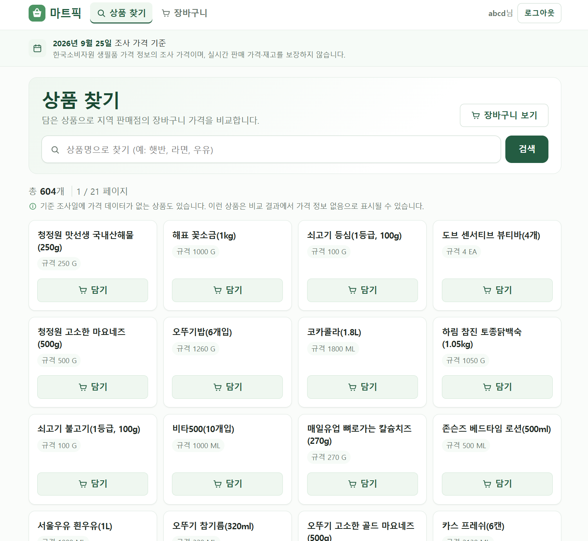
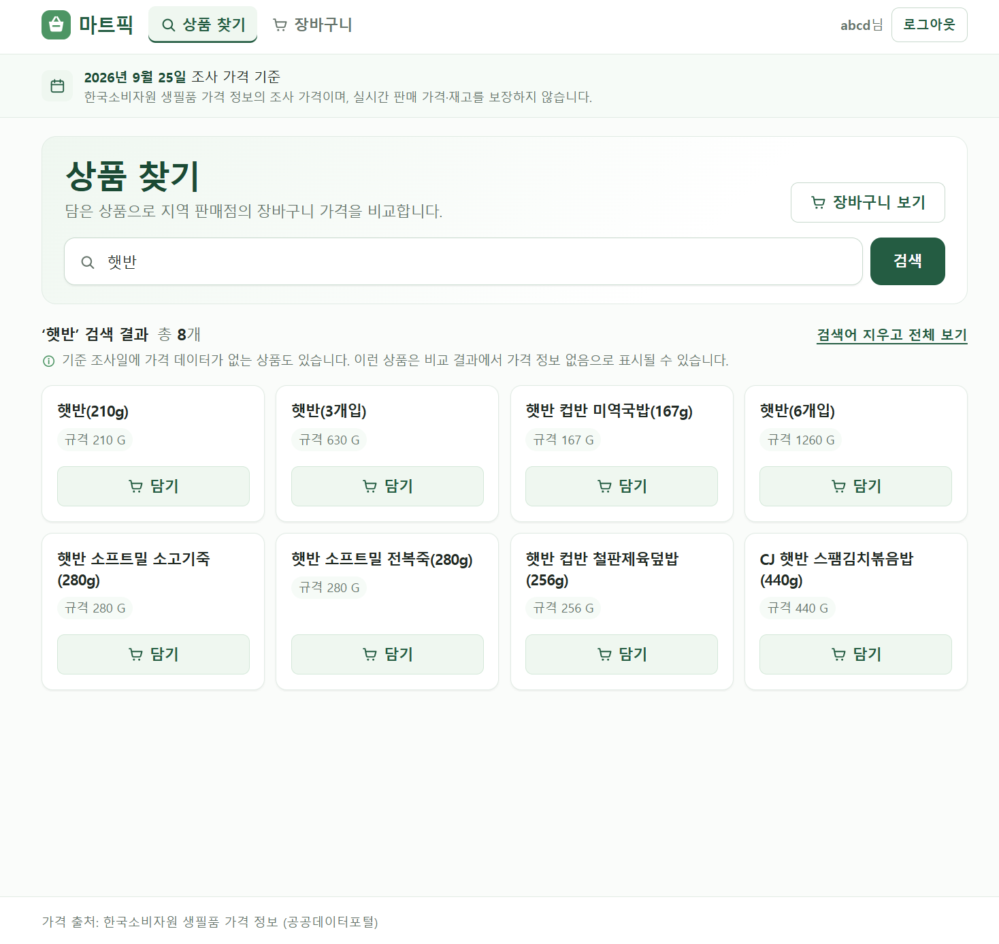
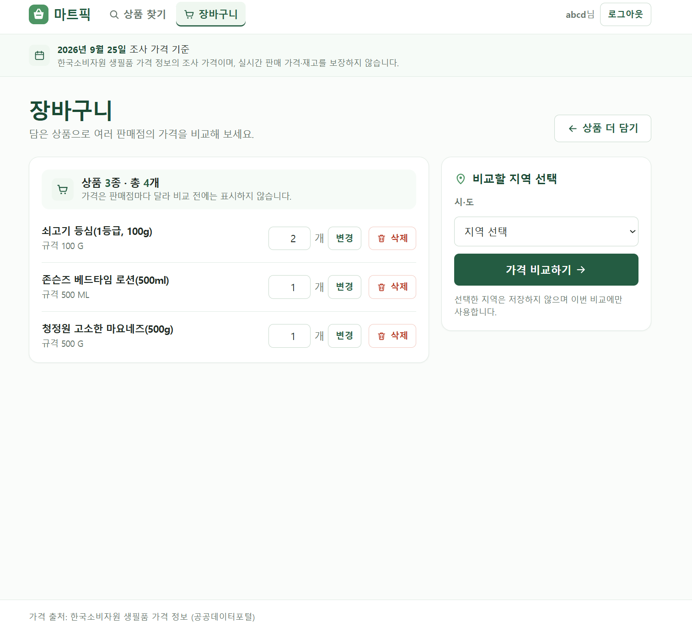
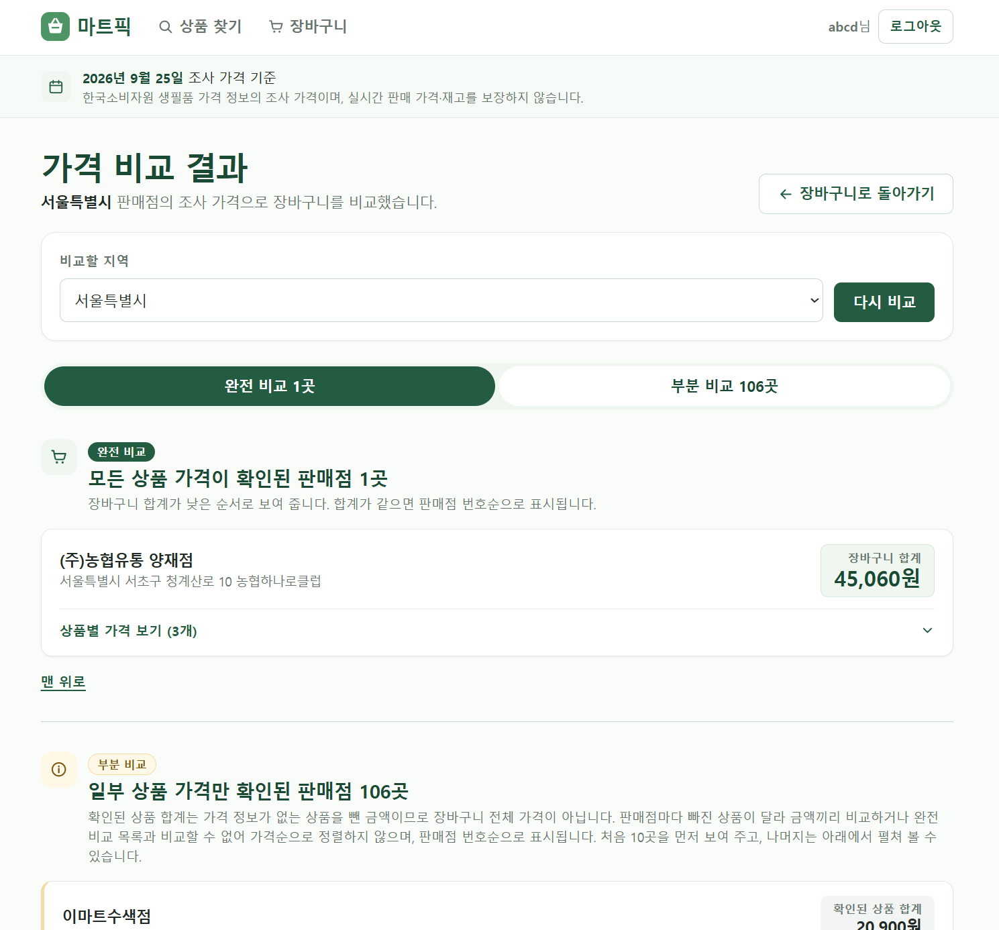
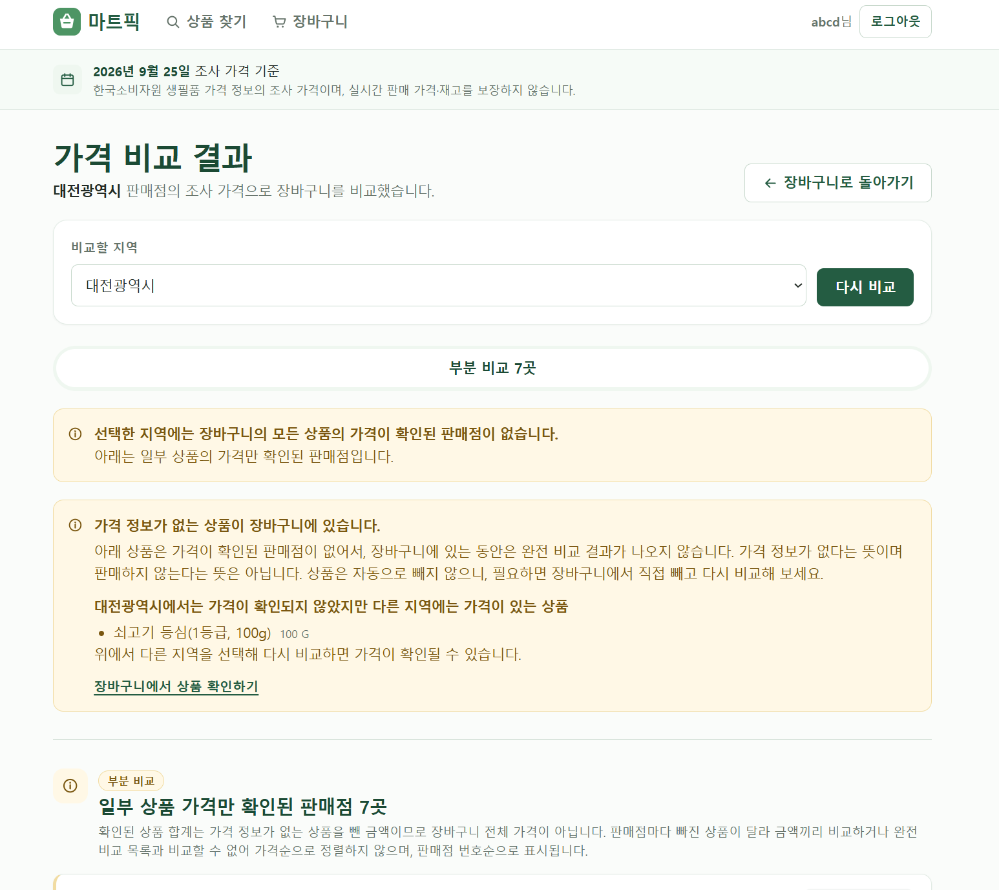

# MartPick (마트픽)

MartPick은 장바구니에 담은 생필품의 총액을 지역별 판매점마다 비교하는 웹서비스입니다. 상품별 최저가가 아니라 한 판매점에서 장바구니 전체를 살 때의 비용을 비교합니다. 한국소비자원의 생필품 가격 정보(공공데이터)를 수집해 PostgreSQL에 저장하고, 이를 바탕으로 가격을 계산합니다.

> **상태**: 주요 기능 구현을 마쳤습니다. Docker 이미지(`Dockerfile`)로 Render 무료 플랜에 시연용으로 단기 배포해 검색·장바구니·가격 비교와 회원가입·로그인·로그아웃을 확인했습니다. 배포 주소는 공개하지 않으며, 시연이 끝나면 서비스와 DB를 삭제할 예정입니다.

## 주요 기능

- **상품 검색**: 상품명 검색과 30개 단위 페이지 이동. 검색어를 공백으로 나눈 단어가 모두 상품명에 들어 있으면 찾습니다(공백 위치·대소문자 무시).
- **장바구니**: 비회원은 세션, 회원은 DB에 저장합니다. 상품당 수량은 1~99개입니다.
- **지역별 가격 비교**: 시·도를 고르면 판매점별 총액을 계산합니다.
  - 모든 상품의 가격이 있는 판매점은 총액순으로 보여 줍니다(완전 비교).
  - 일부 상품만 가격이 있는 판매점은 확인된 합계와 빠진 상품을 따로 보여 줍니다(부분 비교).
  - 가격 데이터가 없는 상품은 "전국에 없음"과 "선택 지역에만 없음"으로 나누어 안내하며, 임의로 제외하지 않습니다.
- **회원**: 회원가입, 세션 기반 로그인·로그아웃. 로그인해도 비회원 장바구니를 합치지 않으며, 그 사실을 화면에서 안내합니다.

## 서비스 화면

Render 무료 플랜 배포 환경에서 캡처한 화면입니다(시연용 임시 계정으로 로그인한 상태).

**상품 찾기**: 수집한 전체 상품(604개)을 30개씩 보여 줍니다.



**검색**: 검색어 `햇반`의 결과입니다.



**장바구니**: 비교 전에는 가격을 표시하지 않고, 비교할 시·도를 고릅니다.



**가격 비교 결과(서울)**: 모든 상품의 가격이 확인된 판매점(완전 비교)과 일부만 확인된 판매점(부분 비교)을 나누어 보여 줍니다.



**가격 정보가 없는 상품 안내(대전)**: 선택한 지역에만 가격이 없는 상품을 따로 알려 주고, 상품은 자동으로 빼지 않습니다.



## 기술 스택

| 구분 | 내용 |
|---|---|
| 언어·프레임워크 | Java 17, Spring Boot 3.5.16 (Web MVC, Validation, Security, Data JPA) |
| 화면 | Thymeleaf 서버 사이드 렌더링, HTML/CSS (프론트엔드 프레임워크 없음) |
| DB | PostgreSQL 16, 스키마는 Flyway로 관리, Hibernate `ddl-auto: validate` |
| 인증 | 세션 기반 폼 로그인, BCrypt, CSRF 기본값 유지 |
| 테스트 | JUnit 5, AssertJ, Mockito, Spring Security Test |
| 빌드 | Gradle 8.14.5 (Wrapper) |

REST API 서버와 프론트엔드를 나누지 않은 단일 Spring Boot 애플리케이션이며, Controller → Service → Repository 3계층으로 구성했습니다.

## 핵심 구현

**데이터 수집과 저장**
- 공공데이터 API를 사용자 요청 시에는 호출하지 않습니다. 수집기를 수동으로 1회 실행해 DB에 저장하고, 서비스는 그 데이터로만 비교합니다.
- 응답을 모두 받아 검증한 뒤 단일 트랜잭션으로 저장합니다. 이전 성공 이력과 크게 다르면(가격 건수 급감 등) 저장하지 않고 중단합니다.
- 모든 가격은 기준 조사일 하나로 고정합니다(`martpick.inspect-day`). 다른 조사일의 가격은 섞지 않습니다.
- 첫 전체 수집 결과는 상품 604개, 가격 113,843건입니다(2026-10-01 확인).

**가격 비교**
- 장바구니(상품 ID·수량), 지역, 기준 조사일을 입력으로 받아 계산합니다. 회원·인증 정보에 의존하지 않아 비회원과 회원 장바구니가 같은 계산을 씁니다.
- 가격이 없는 상품은 총액에서 조용히 빠지지 않습니다. 모든 상품이 확인된 판매점과 일부만 확인된 판매점을 나누는 이유입니다.

**장바구니와 회원**
- 서비스가 로그인 여부에 따라 세션 장바구니와 DB 장바구니(`cart_item`)를 나눕니다. 회원은 요청 값이 아니라 인증 정보로만 식별합니다.
- 수량 범위와 `(회원, 상품)` 유일성은 DB 제약으로도 막습니다. 같은 회원의 동시 담기가 한 행으로 합쳐지는 것을 테스트로 확인했습니다.
- 로그인 후 복귀 주소(`continue`)는 허용 목록(`/products`, `/cart`, `/compare`)만 받습니다.

## 로컬 실행

필요한 것: JDK(Gradle이 Java 17 툴체인을 사용), Docker. 아래 명령은 Windows 기준입니다.

```bash
docker compose up -d      # PostgreSQL 16 컨테이너 (개발 DB martpick, 테스트 DB martpick_test)
./gradlew.bat bootRun     # http://localhost:8080, 스키마는 시작 시 Flyway가 적용
```

위 명령은 애플리케이션과 DB를 실행하지만 상품·가격 데이터를 자동으로 수집하지는 않습니다(Flyway는 빈 테이블만 만들고, 수집기는 기본으로 꺼져 있습니다). 가격 비교 기능을 사용하려면 별도로 공공데이터 수집을 진행해야 하며, 절차는 [docs/PROJECT_SPEC.md](docs/PROJECT_SPEC.md) 4장을 참고해 주세요.

DB 접속은 환경변수(`MARTPICK_DB_HOST`, `MARTPICK_DB_PORT`, `MARTPICK_DB_NAME`, `MARTPICK_DB_USER`, `MARTPICK_DB_PASSWORD`)로 바꿀 수 있습니다. 기본값(`martpick`/`martpick`)은 **로컬 개발 전용**이며 운영에서 쓰면 안 됩니다. 공공데이터 수집에만 `DATA_GO_KR_SERVICE_KEY`가 필요합니다.

## 테스트

```bash
./gradlew.bat cleanTest test
```

- 서비스·컨트롤러 단위 테스트와, 실제 PostgreSQL과 보안 필터를 거치는 통합 테스트로 나뉩니다. DB 연동 테스트는 실제 PostgreSQL을 사용합니다.
- 일부 테스트는 실제 Tomcat을 띄워 확인합니다(로그인 우회 시도, 긴 URL 등 MockMvc로는 재현되지 않는 경우).
- 테스트는 개발 DB가 아니라 `martpick_test`에 연결합니다. 실행 전에 `docker compose up -d`로 로컬 DB가 떠 있어야 합니다.
- DB 연동 테스트는 `test` 프로필을 사용하며, 데이터 전체 삭제가 필요한 테스트에는 DB 이름을 검증하는 안전장치를 추가했습니다.
- 테스트 DB로 화면을 확인하려면 `./gradlew.bat bootRunTest`를 씁니다(`127.0.0.1`에만 바인딩). 일반 `bootRun`은 개발 DB에 연결됩니다.

## 알려진 한계와 주의사항

**데이터**
- 조사 가격이며 실시간 가격이나 재고를 보장하지 않습니다. 화면에도 같은 문구가 있습니다.
- 가격은 기준 조사일(2026-09-25) 하나뿐이고, 비교 지역은 시·도 단위입니다.
- 판매점명에 `(본사)`가 붙은 곳은 개별 방문 가능 매장으로 확인되지 않아 비교에서 제외합니다. 편의점 업태에는 이 4곳뿐이라 결과적으로 편의점은 나타나지 않습니다. 판별이 판매점명 패턴과 사람이 확인한 ID 목록에 의존하므로, 같은 성격의 판매점이 추가되면 자동으로 제외되지 않을 수 있습니다.

**보안과 의존성**
- Spring Boot 3.5.x는 2026-06-30에 OSS 지원이 종료되어 새 보안 패치를 기대할 수 없습니다. 이 프로젝트는 3.5.16을 유지합니다.
- `spring-webmvc` 6.2.19의 취약점 2건(GHSA-j9f9-w8pj-32f8, GHSA-pc63-qcmh-9cmg)은 **해결되지 않았습니다.** 6.2.x의 수정 버전(6.2.20)은 Enterprise Support 전용이고 공개 수정은 7.0.9부터라, 해결하려면 Spring Boot 4.x로 올려야 합니다. 정적 분석에서는 이 앱이 발생 조건을 쓰지 않는 것으로 확인했을 뿐입니다. 조회 결과와 판단 근거는 [docs/PROJECT_SPEC.md](docs/PROJECT_SPEC.md) 6장에 있습니다.
- 로그인 시도 횟수 제한은 없습니다. HTTPS·쿠키 `Secure`/`SameSite`·세션 만료 시간은 저장소(`application.yml`)에 설정되어 있지 않고, 배포에서는 환경변수로 지정했습니다.

## 문서

- [docs/PROJECT_SPEC.md](docs/PROJECT_SPEC.md): 요구사항, 화면, 비즈니스 규칙, 취약점 조회 결과
- [docs/API_RESEARCH.md](docs/API_RESEARCH.md): 공공데이터 API 실제 응답으로 확인한 사실과 미검증 사항
- [AI_COLLABORATION.md](AI_COLLABORATION.md): AI Agent(Claude Code)와의 협업 기록
